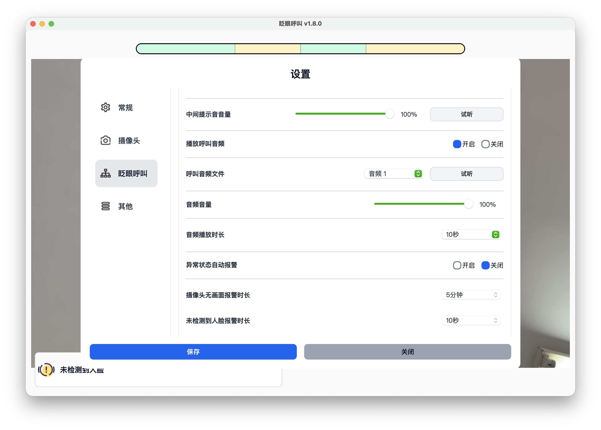

# Audio Alert

Audio settings determine whether calls ring, which ringtone is used, its volume and playback duration, and whether short cues play after blink steps.

Open:

**Settings → Blink Call**

After making changes, click **Save** and complete a test call.

## Enable Call Audio

Set **Play call audio** to **On**.

When enabled, completing the blink sequence plays the ringtone and displays the call alert.

When disabled, completing the sequence does not play the call ringtone or display the call alert. Keep it enabled for daily calls.

## Select and Preview a Ringtone

1. Select a ringtone under **Call audio file**.
2. Click **Preview**.
3. Confirm that it can be heard through the computer or Bluetooth speaker.
4. If needed, choose another ringtone and preview it again.

A successful preview confirms only that the sound device and ringtone can play. After saving, complete a full test call as well.

## Adjust the Volume

The two sounds have separate volume controls:

- **Audio volume** controls the call ringtone and automatic abnormality alerts.
- **Stage prompt volume** controls the short cue after each blink step. Click **Preview** next to it to check the cue separately.

These controls do not change the Windows system volume. The sound you hear also depends on the computer speakers, Bluetooth speaker, and Windows volume settings.

!!! tip
    Preview the sounds at the patient's actual location. If the alert needs to be heard across rooms, have the caregiver check it from their usual location.

## Set the Playback Duration

**Audio play duration** determines how long a call ringtone plays. Choose a fixed duration or **Unlimited**.

- With a fixed duration, the ringtone stops when the configured time is reached.
- With **Unlimited**, it continues until the patient or caregiver clicks the red call alert button.

Consider how long the caregiver usually needs to hear and respond to an alert.

## Alert When the Camera or Face Is Missing

Turn on **Automatic abnormality alert** to set separate delays for a camera without new frames and a face that remains undetected. Both delays default to 5 minutes.

The alert uses the selected ringtone and **Audio volume**, and loops continuously. The relevant alert stops automatically when the camera view or face detection recovers. To silence it manually, click the red alarm button labeled **Tap to silence**; it will not ring again until the current abnormal condition clears. This feature works independently of **Play call audio** and the normal call playback duration.

## Set Blink Step Prompt Sounds

Each action under **Blink sequence** has a **Sound prompt** option.

When enabled, the software plays a short cue after the patient completes that eye-open or eye-closed step, indicating that they can continue to the next action. This cue is different from the final call ringtone.

Enable cues for key steps if watching the progress bar continuously is difficult. If the cues are distracting, disable them individually.

## Check After Saving

After saving the settings, confirm that:

1. **Preview** plays the ringtone.
2. The software volume and Windows volume are appropriate.
3. The Bluetooth speaker remains connected as the correct playback device.
4. Completing a blink sequence displays the call alert and plays the ringtone.
5. Clicking the red call alert button stops the ringtone early.

If you cannot hear the alert, see [No Alert Sound](troubleshooting.md#no-sound).
